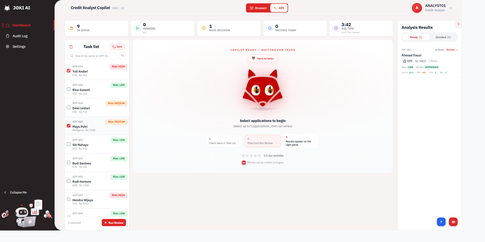
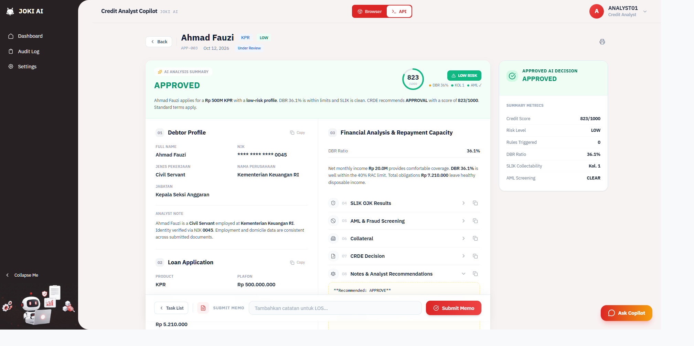
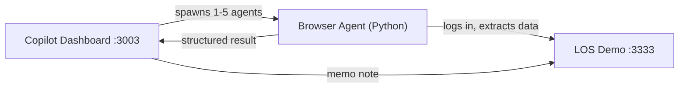

# Credit Analyst Copilot

[](https://bun.sh)
[](LICENSE)


An AI-powered credit analyst assistant: it automates loan application review by extracting data from a Loan Origination System (LOS), generating credit memos with full rule-engine context (CRDE, SLIK OJK, AML/fraud), and letting the analyst question and finalize every case with a grounded Copilot chat.

> 🏆 Winning build of **Octo Hackfest 2026** — kept as a working reference implementation. All debtor data is fictional.

## Screenshots

**Batch review** — select up to 5 applications, run agents in parallel, results stream into the right panel:



**Memo review** — rule-engine results, AI recommendation, grounded Copilot chat, one-click submit back to the LOS:



## What's Inside

| Component | Tech | Port | Description |
|---|---|---|---|
| **LOS Demo** | React + Bun + SQLite | `3333` | Mock loan origination system with debtor profiles, SLIK OJK, AML/fraud, CRDE scoring |
| **Copilot Dashboard** | React + Bun + WebSocket | `3003` | AI agent orchestration, real-time browser automation, credit memo review, analyst chat |

## Highlights

- **Batch reviews** — up to 5 applications in parallel, with live step-by-step progress and browser screenshots streamed over WebSocket
- **Grounded memos** — bilingual (EN/ID), credit-policy-aware through editable Juknis skills in `dashboard/skills/`
- **Explainable analysis** — CRDE rule results, SLIK collectability, and AML/fraud signals shown next to the AI recommendation
- **Copilot chat** — ask follow-up questions about the extracted case data; answers stay grounded in the file
- **Pluggable LLMs** — Anthropic, Google Gemini, or any OpenAI-compatible endpoint (OpenRouter, Ollama, vLLM); a separate browsing model can be configured
- **Zero-key demo** — mock mode runs the full flow on seeded fixtures, no API keys or Python required

## How It Works



1. The dashboard spawns a headless browser agent per application (`browser-use` + Playwright); it logs into the LOS and reads the **Data Summary** tab in one JavaScript evaluation pass.
2. A second LLM call turns the extracted data plus the active credit-policy skills into a formal memo.
3. Submitted memos are written back into the LOS app as analyst notes; every step lands in the audit log.

## Quick Start

**Prerequisites:** [Bun](https://bun.sh) v1.1+ · Python 3.11+ *(optional — only for real browser extraction; mock mode works without it)*.

### One command (Windows)

```powershell
.\start-demo.ps1        # or: start-demo.bat
```

Resets the database and starts both servers.

### Manual / cross-platform

```bash
# Terminal 1 — LOS demo (http://localhost:3333)
bun install
bun run server/db/seed.ts --reset
bun run server/index.ts

# Terminal 2 — Copilot Dashboard (http://localhost:3003)
cd dashboard
bun install
bun run server/index.ts
```

Or start both at once with `concurrently`:

```bash
bun run demo:seed   # reset DB + start everything
bun run demo        # start without reset
```

## Demo Flow

1. Open the dashboard → `http://localhost:3003` — sign in as `analyst01` (any of `analyst01`–`analyst05`, password `bms2025`)
2. Select up to 5 applications → **Run Review**
3. Watch the agent work in real time — or flip **Sim** in the header to replay a scripted run instantly
4. Open the finished session → **Review →** the generated memo; ask Copilot follow-ups
5. **Submit Memo** — it lands in the LOS app for the analyst's final decision

## Configuration

Dashboard settings are editable at `http://localhost:3003/settings` or via `dashboard/.env`:

```bash
cp dashboard/.env.example dashboard/.env
```

| Variable | Description |
|---|---|
| `LLM_PROVIDER` | `anthropic`, `gemini`, or `custom` (OpenAI-compatible) |
| `ANTHROPIC_API_KEY` / `ANTHROPIC_MODEL` | Claude credentials |
| `GEMINI_API_KEY` / `GEMINI_MODEL` | Gemini credentials |
| `CUSTOM_LLM_ENDPOINT` / `CUSTOM_LLM_MODEL` / `CUSTOM_LLM_API_KEY` | OpenRouter, Ollama, vLLM, etc. |
| `BROWSE_PROVIDER` / `BROWSE_MODEL` / `BROWSE_ENDPOINT` / `BROWSE_API_KEY` | Separate model for the browsing agent (defaults to the main LLM) |
| `LOS_URL` | Loan Origination System base URL |
| `LOS_USERNAME` / `LOS_PASSWORD` | LOS login credentials |
| `LOS_LOGIN_PATH` | LOS login page path (default: `/login`) |
| `EXTRACTION_MODE` | `browser` (LLM navigates the UI) or `api` (direct REST calls) |
| `MOCK_AGENT` | `true` = no Python, seeded fixtures only |

## Project Structure

```
├── client/                 # LOS demo frontend
├── server/                 # LOS demo backend (Bun + SQLite)
├── data/                   # SQLite database (created by seed, git-ignored)
├── dashboard/
│   ├── client/             # Dashboard frontend
│   ├── server/             # Dashboard backend (orchestration, memos, audit)
│   ├── agent/              # Python browser automation agent
│   ├── skills/             # Credit policy / juknis skills (editable in the UI)
│   └── .env.example        # Config template
├── deploy/                 # Deployment (start with render/ — the tested path)
├── docs/                   # PRDs, architecture, ADRs, review notes, hackathon deck
├── CLAUDE.md               # Contributor / AI-coding-agent guide
└── start-demo.ps1          # One-command Windows starter
```

## Documentation

| Doc | Contents |
|---|---|
| [PRD — LOS demo](docs/PRD-demo-los.md) · [PRD — Copilot Dashboard](docs/PRD-copilot-dashboard.md) | Product specs for both apps |
| [FLOW.md](docs/FLOW.md) · [demo-architecture.md](docs/demo-architecture.md) | End-to-end flows and architecture |
| [AGENT-REVIEW.md](docs/AGENT-REVIEW.md) | Browser-agent review & debugging checklist |
| [SECURITY.md](docs/SECURITY.md) | Security posture of the demo |
| [docs/adr/](docs/adr/) · [docs/review/](docs/review/) | Decision records · repo cleanup log & improvement roadmap |
| [docs/hackathon/](docs/hackathon/) | Octo Hackfest 2026 deck & materials |

## Tech Stack

- **Runtime:** Bun
- **Frontend:** React 18, React Router, Tailwind CSS
- **Backend:** Bun.serve, Bun SQLite
- **Agent:** Python + Playwright + browser-use
- **LLMs:** Anthropic Claude, Google Gemini, or any OpenAI-compatible API

## Deployment

`deploy/render/` is the tested path (single container + persistent disk for SQLite). `deploy/` also has guides for Railway, Fly.io, AWS EC2, and GCP. The full stack needs a long-running Bun process with a persistent disk — serverless/static-only platforms can't run it.

## License

MIT — see [LICENSE](LICENSE). All debtor data, scores, and documents are fictional and seeded for demonstration.
